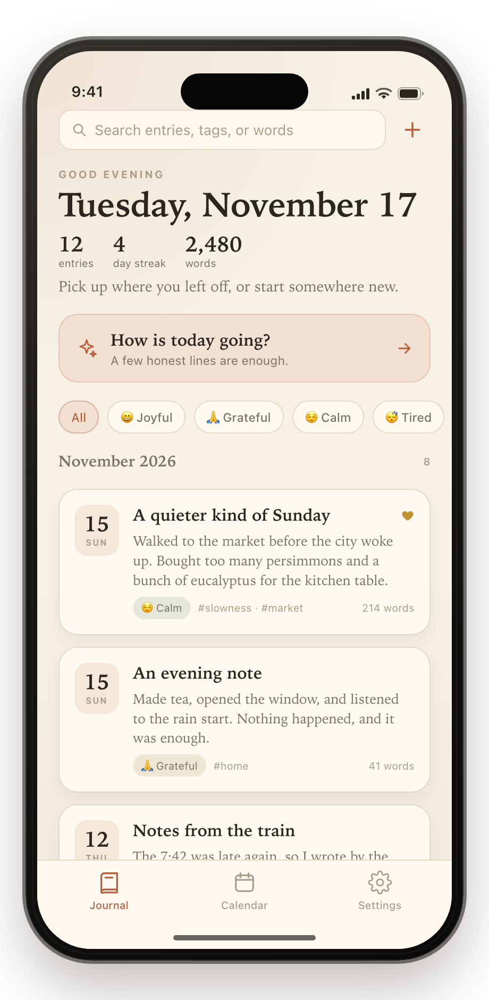
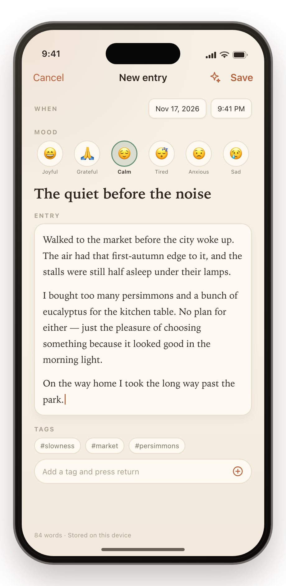
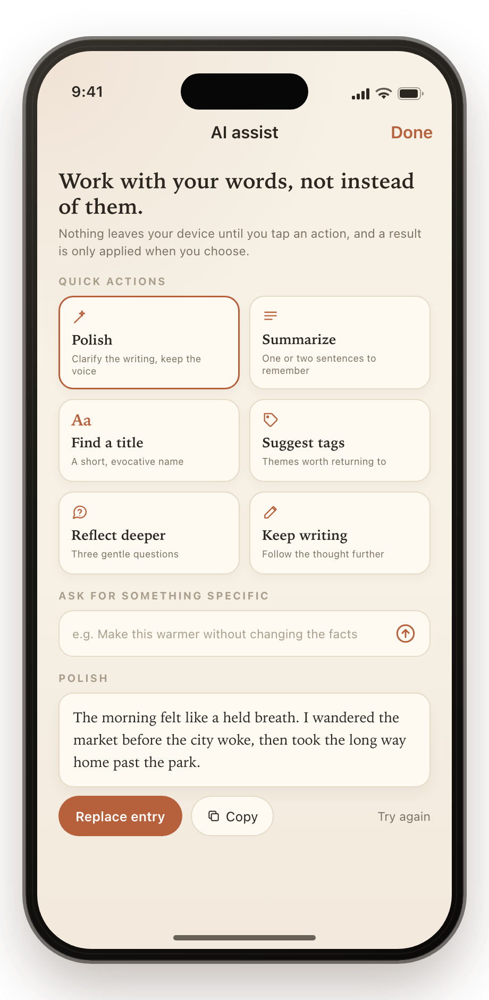
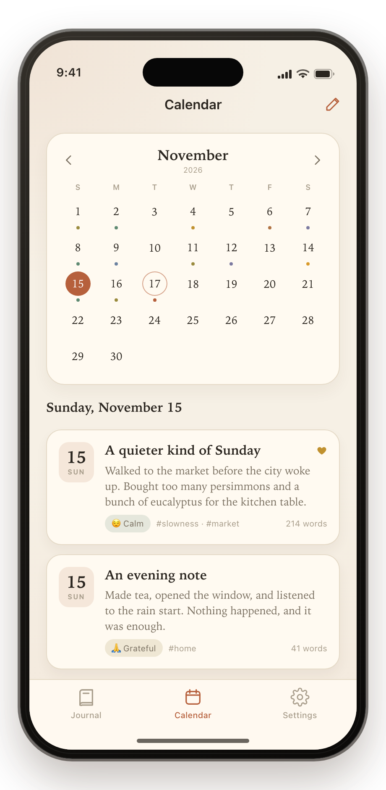
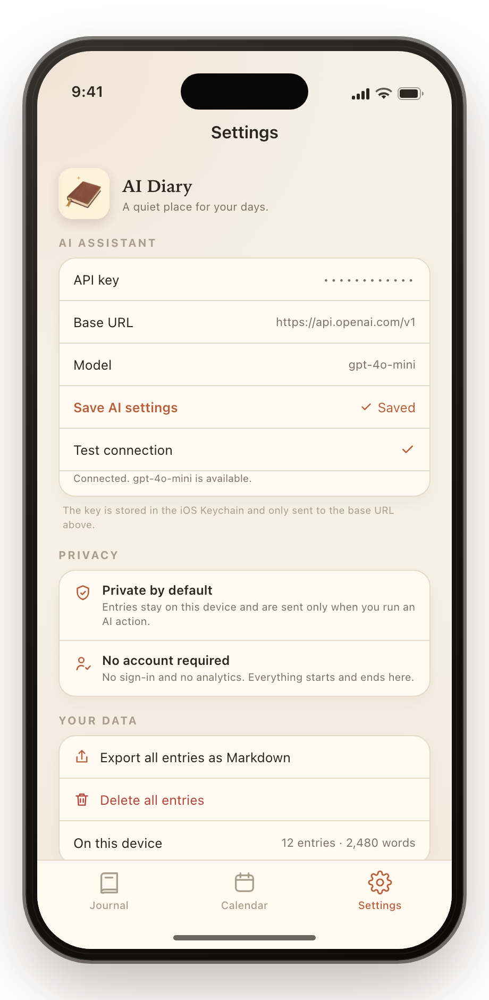

# AI Diary

A private, warm-paper journal for iPhone and iPad. Built with SwiftUI and SwiftData, with an optional AI writing assistant that uses your own OpenAI-compatible API key.

<p align="center">
  <a href="docs/previews/journal.png"></a>
  <a href="docs/previews/editor.png"></a>
  <a href="docs/previews/ai-assist.png"></a>
</p>
<p align="center">
  <a href="docs/previews/calendar.png"></a>
  <a href="docs/previews/settings.png"></a>
</p>
<p align="center"><em>Design previews rendered from the app's layout and warm-paper theme (sources in <code>docs/previews/</code>). They are illustrative mockups, not simulator screenshots.</em></p>

## Features

- **Offline-first journal** — entries are stored locally with SwiftData; no account, sign-in, or sync required.
- **Warm paper design** — cream surfaces, serif typography, terracotta accents, mood colors, and full dark mode support.
- **Journal feed** — month-grouped entries with full-text search, mood filters, favorites, streaks, and word counts.
- **Calendar** — month grid with mood-colored dots for each day; browse or write for any past day.
- **Rich entries** — title, body, date and time, mood, tags, favorite, word count, and an optional AI summary.
- **AI assist (bring your own key)** — polish, summarize, suggest a title, suggest tags, reflection questions, continue writing, or a custom instruction. Results stream into the sheet and are only applied when you confirm.
- **Privacy-minded** — API key lives in the iOS Keychain; entries are sent to your provider only when you tap an AI action.
- **Export** — share all entries as Markdown from Settings.

## Requirements

- Xcode 16 or later (the project uses Xcode 16 file-system synchronized groups)
- iOS / iPadOS 17.0 or later
- No third-party dependencies

## Getting started

1. Open `AIDiary.xcodeproj`.
2. Select the **AIDiary** target → **Signing & Capabilities** → choose your Team, and change the bundle identifier if needed.
3. Choose an iPhone or iPad simulator and press **Run**.

New files added anywhere inside the `AIDiary/` folder are picked up automatically by the synchronized group.

## AI setup (optional)

1. Open the **Settings** tab → **AI assistant**.
2. Enter:
   - **API key** — stored in the Keychain, never in UserDefaults.
   - **Base URL** — defaults to `https://api.openai.com/v1`.
   - **Model** — defaults to `gpt-4o-mini`.
3. Tap **Test connection**, then **Save AI settings**.

Any provider that implements the OpenAI-style `POST /chat/completions` endpoint with server-sent-event streaming works, for example OpenAI, OpenRouter, LM Studio, or Ollama's OpenAI-compatible API.

The request flow is deliberately minimal:

- `GET /models` for the connection test, with a tiny chat completion as fallback for providers that do not expose it.
- `POST /chat/completions` with `stream: true` for AI actions.

## Privacy and security

- Entries and settings stay in the app's local container.
- The API key is stored with `kSecAttrAccessibleAfterFirstUnlock` in the Keychain.
- There is no analytics, tracking, or third-party SDK.
- Diary text is sent to the configured endpoint only when you explicitly run an AI action. Check your provider's data policy before using sensitive content.

## Project layout

```
AIDiary/
  AIDiaryApp.swift          App entry point and SwiftData container
  Models/
    DiaryEntry.swift        SwiftData model, derived text helpers, streak stats
    Mood.swift              Mood options
  Services/
    AIConfiguration.swift   Persisted base URL/model, Keychain-backed key
    OpenAIService.swift     Streaming OpenAI-compatible client
    SSEParser.swift         Server-sent-event delta parsing
    AIPrompts.swift         Actions, prompt templates, tag parsing
    KeychainStore.swift     Keychain wrapper
    MarkdownExporter.swift  Markdown export
  Theme/
    Theme.swift             Warm-paper colors, backgrounds, fonts
    Components.swift        Pills, chips, mood picker, buttons
  Views/
    RootView.swift          Tab container
    JournalView.swift       Feed, search, filters, empty states
    EntryRow.swift          Entry card
    EntryDetailView.swift   Read view with share and edit
    EntryEditorView.swift   Compose/edit, tags, mood, AI entry point
    AIAssistView.swift      Action grid, streaming results, apply flow
    CalendarView.swift      Month grid and selected-day entries
    SettingsView.swift      AI config, connection test, export, delete all
```

## Notes

- App Transport Security blocks plain-HTTP endpoints. Use HTTPS, or add a narrow ATS exception for local development if you are testing a local model server.
- The project intentionally has no test target; the network and prompt logic is isolated in `Services/` for easy unit testing.
- All AI output is editable and only applied after an explicit choice — nothing overwrites an entry automatically.